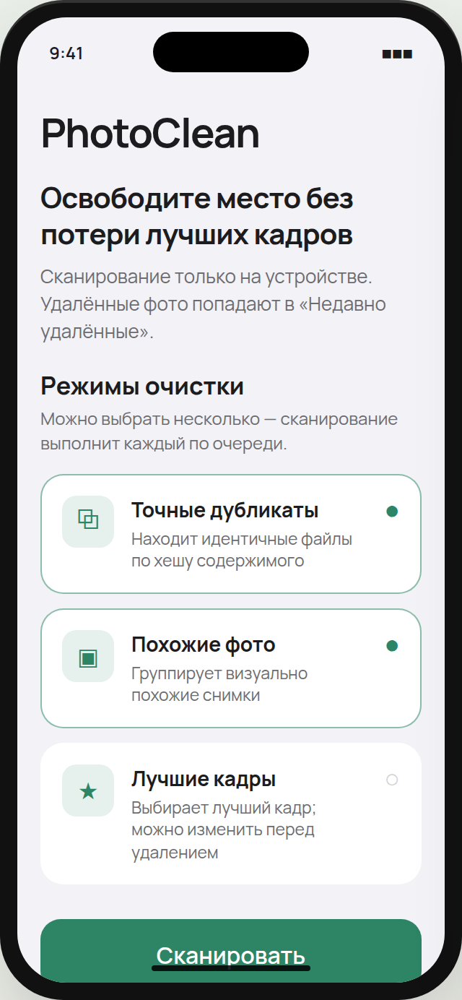
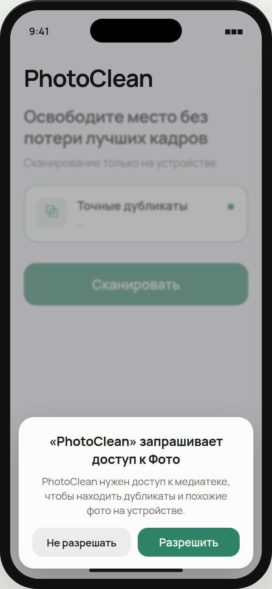
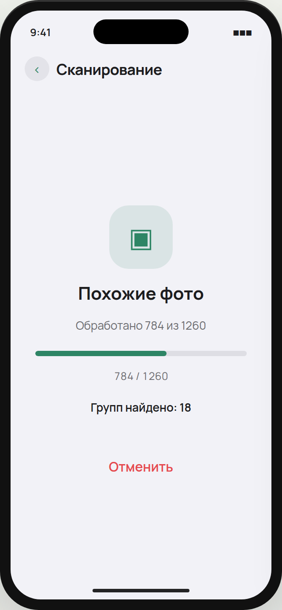
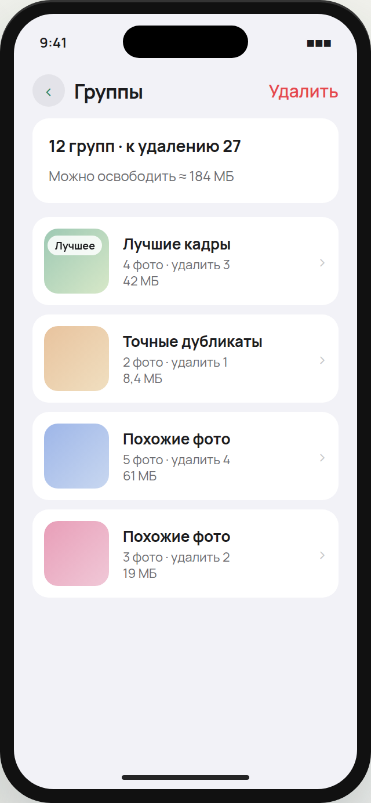
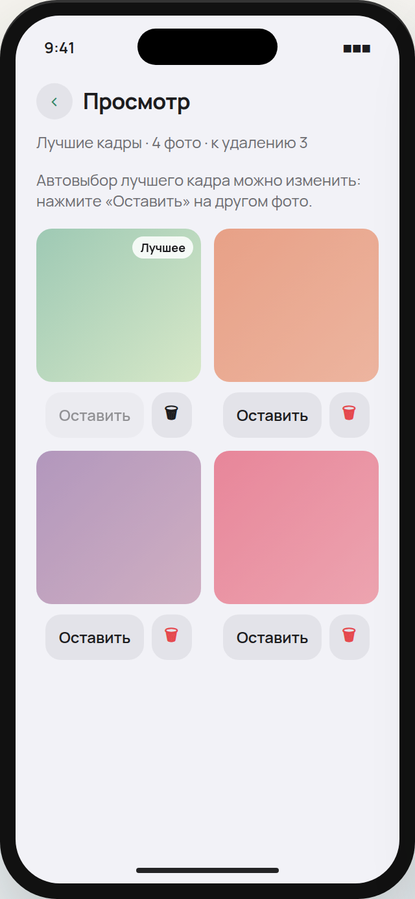
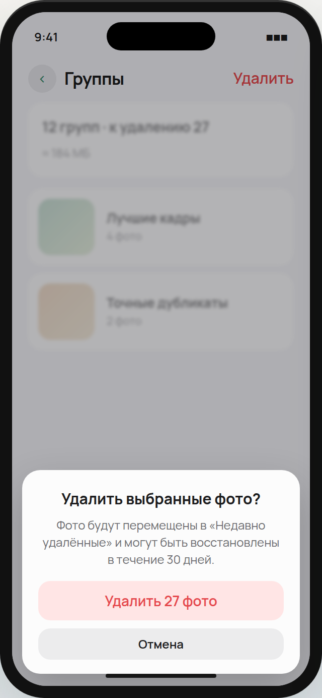
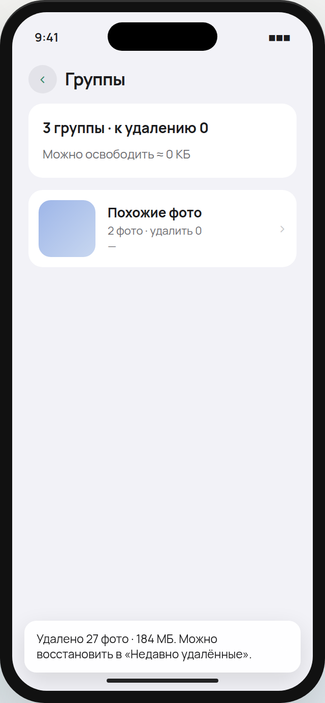

# PhotoClean

Нативное iOS-приложение на **Swift / SwiftUI** для очистки медиатеки iPhone.

Находит **точные дубликаты**, **похожие фото** и помогает оставить **лучший кадр** с ручным подтверждением перед удалением. Всё сканирование — **только на устройстве**. Удалённые снимки попадают в альбом **«Недавно удалённые»** (можно восстановить до 30 дней).

| | |
|---|---|
| Платформа | iPhone, iOS **18.0+** (в т.ч. iPhone 17 Pro) |
| Стек | Swift, SwiftUI, Photos framework |
| Bundle ID | `com.example.PhotoClean` *(замените на свой)* |
| Версия | 1.0.0 (build 1) |
| Язык UI | русский |

---

## Содержание

1. [Макеты экранов](#макеты-экранов)
2. [Пользовательский поток](#пользовательский-поток)
3. [Режимы очистки](#режимы-очистки)
4. [Как открыть в Xcode](#как-открыть-в-xcode)
5. [Разрешения (Photos)](#разрешения-photos)
6. [Запуск на симуляторе и устройстве](#запуск-на-симуляторе-и-устройстве)
7. [TestFlight](#testflight)
8. [Структура проекта](#структура-проекта)
9. [Ограничения](#ограничения)

Интерактивная галерея макетов: [`docs/mockups/index.html`](docs/mockups/index.html)

---

## Макеты экранов

Визуальные макеты соответствуют текущему SwiftUI-потоку приложения.

### 1. Главный экран — выбор режимов

Можно отметить несколько режимов сразу. Кнопка **«Сканировать»** запускает анализ.



### 2. Запрос доступа к Фото

Системный диалог `PHPhotoLibrary.requestAuthorization(for: .readWrite)`. Для полного результата нужен доступ ко **всем фото**, не только к выбранным.



### 3. Сканирование

Прогресс загрузки медиатеки → хеширования → группировки. Можно **отменить**.



### 4. Список групп

Сводка: сколько групп, сколько фото к удалению, примерный объём. Тап по группе открывает превью.



### 5. Превью группы — выбор keep / delete

В режиме «Лучшие кадры» лучший снимок помечается автоматически. Кнопка **«Оставить»** меняет выбор вручную; корзина включает/выключает удаление (хотя бы одно фото в группе всегда остаётся).



### 6. Подтверждение удаления

Перед удалением — диалог. Фото уходят в **«Недавно удалённые»** через Photos API (`PHAssetChangeRequest.deleteAssets`).



### 7. Результат

Баннер с числом удалённых фото и освобождённым объёмом; список групп обновляется.



---

## Пользовательский поток

```text
Главный экран
   │  выбор режимов (1–3)
   ▼
Доступ к Фото (если ещё не выдан)
   ▼
Сканирование (прогресс / отмена)
   ▼
Список групп
   │
   ├─► Превью группы → «Оставить» / корзина
   │
   └─► Удалить выбранные → подтверждение
           ▼
       «Недавно удалённые» (+ баннер результата)
```

| Шаг | Экран | Что делает пользователь |
|-----|--------|-------------------------|
| 1 | Главный | Выбирает режимы, жмёт «Сканировать» |
| 2 | Системный диалог | Разрешает доступ к медиатеке |
| 3 | Сканирование | Ждёт прогресс или отменяет |
| 4 | Группы | Просматривает найденные наборы |
| 5 | Просмотр | Меняет keep/delete вручную |
| 6 | Диалог | Подтверждает удаление |
| 7 | Группы | Видит итог и может продолжить |

---

## Режимы очистки

| Режим | Как работает | Что удаляется по умолчанию |
|-------|--------------|----------------------------|
| **Точные дубликаты** | SHA-256 содержимого файла (или pixel-fingerprint) | Все копии, кроме одной |
| **Похожие фото** | Perceptual aHash, Hamming ≤ 8 | Все, кроме одной в кластере |
| **Лучшие кадры** | Похожие + эвристика качества (разрешение, размер, избранное, соотношение сторон) | Все, кроме автовыбранного «лучшего»; можно переопределить |

Несколько режимов можно включить сразу — они выполняются **по очереди**, группы с одинаковым составом фото схлопываются.

---

## Как открыть в Xcode

**Требования:** macOS, **Xcode 16+**, Apple ID.

```bash
git clone https://github.com/Homavi88/PhotoClean.git
cd PhotoClean
open PhotoClean.xcodeproj
```

1. Выберите target **PhotoClean**.
2. *Signing & Capabilities* → укажите свою **Team** (Automatic signing).
3. При желании смените Bundle Identifier:

   `com.example.PhotoClean` → `com.вашеимя.PhotoClean`

4. Выберите симулятор или iPhone → **Run** (⌘R).

---

## Разрешения (Photos)

Файлы: `PhotoClean/Resources/Info.plist`, `PrivacyInfo.xcprivacy`.

| Ключ | Зачем |
|------|--------|
| `NSPhotoLibraryUsageDescription` | Чтение медиатеки для сканирования |
| `NSPhotoLibraryAddUsageDescription` | Совместимость с Photos API |
| `PHPhotoLibraryPreventAutomaticLimitedAccessAlert` | Контроль limited-access UX в приложении |

Текст запроса (кратко): *«PhotoClean нужен доступ к медиатеке, чтобы находить дубликаты и похожие фото на устройстве.»*

Приложение **не загружает** фото в облако и **не ведёт** трекинг (`NSPrivacyTracking = false`).

Если доступ запрещён или ограничен — на главном экране баннер с кнопкой **«Открыть Настройки»**.

---

## Запуск на симуляторе и устройстве

### Симулятор

1. Xcode → любой iPhone-симулятор (iOS 18+).
2. Добавьте тестовые фото в приложение **«Фото»** симулятора (перетаскивание файлов или *Features → Photos*).
3. Запустите PhotoClean, разрешите доступ, выберите режимы.

### Устройство (iPhone)

1. Подключите iPhone, доверьте компьютеру.
2. В Signing выберите Team; Xcode создаст профиль.
3. При необходимости: *Настройки → Основные → VPN и управление устройством* — доверьте разработчику.
4. Разрешите доступ к Фото при запросе приложения.

---

## TestFlight

Публиковать в App Store **не обязательно**. Проект уже подготовлен к дистрибуции:

- Bundle ID-заглушка, версия `1.0.0` / build `1`
- Privacy strings + `PrivacyInfo.xcprivacy`
- Shared scheme **PhotoClean** с Archive

**Шаги:**

1. Создайте App ID и приложение в [App Store Connect](https://appstoreconnect.apple.com) со **своим** уникальным bundle id.
2. Xcode: *Product → Archive*.
3. *Distribute App → App Store Connect → Upload*.
4. В App Store Connect добавьте сборку в **TestFlight** (Internal и/или External).
5. Перед внешним тестом может понадобиться короткий Beta App Review; для internal testers обычно достаточно.

Перед внешним TestFlight добавьте иконку **1024×1024** в `Assets.xcassets/AppIcon`.

---

## Структура проекта

```text
PhotoClean/
├── App/                 # Точка входа, NavigationStack
├── Models/              # CleanupMode, PhotoAsset, DuplicateGroup, ScanProgress
├── Services/            # Permissions, Photos, hash, similarity, scan, delete
├── ViewModels/          # AppCoordinator
├── Views/
│   ├── Components/      # ModeCard, PhotoThumbnailView
│   └── Screens/         # Home → Scan → Groups → Detail
├── Utilities/           # SHA-256, perceptual hash, форматтеры
└── Resources/           # Info.plist, Assets, PrivacyInfo.xcprivacy
PhotoClean.xcodeproj/
docs/mockups/            # HTML + PNG макеты экранов
```

---

## Ограничения

- Большие медиатеки сканируются дольше (особенно режимы с perceptual hash).
- iCloud-оригиналы подгружаются при необходимости (`isNetworkAccessAllowed = true`).
- «Лучший кадр» — эвристика; перед удалением всегда можно изменить выбор вручную.
- Иконка App Icon пока placeholder.
- Сборку iOS нужно проверять локально в Xcode (в Linux CI нативный iOS-билд недоступен).

---

## Лицензия

Private / unpublished — по решению владельца репозитория.
